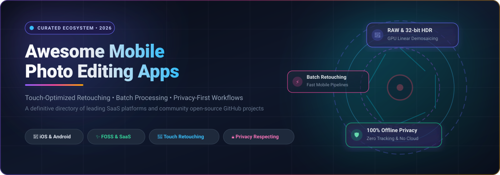
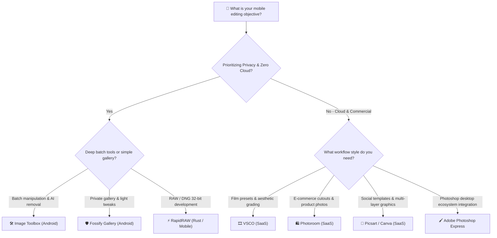

  

  
  
  
  
  
  

---

# 📸 Awesome Mobile Photo Editing Apps & Ecosystem

> **The definitive, search-optimized collection of mobile photo editing applications, touch-optimized retouching software, and open-source image manipulation engines for Android, iOS, and cross-platform creators.**

Whether you are looking for **privacy-first offline Android photo editors** like [Image Toolbox](https://github.com/T8RIN/ImageToolbox), **GPU-accelerated mobile RAW developers** like [RapidRAW](https://github.com/CyberTimon/RapidRAW), or **commercial SaaS powerhouses** like [Adobe Photoshop Express](https://www.adobe.com/products/photoshop-express.html) and [VSCO](https://www.vsco.co/), this guide curates verified pricing tiers, free forever limitations, company scale metrics, and open-source GitHub repositories ranked by community stars.

---

## 📑 Table of Contents

- [📊 Sector Overview & Market Dynamics](#-sector-overview--market-dynamics)
- [🏢 SaaS & Commercial Hosted Platforms](#-saas--commercial-hosted-platforms)
- [🔓 Open-Source GitHub Projects & Frameworks](#-open-source-github-projects--frameworks)
- [🎯 Practical Selection Guide](#-practical-selection-guide)
- [🤝 How to Contribute](#-how-to-contribute)
- [⚠️ Disclaimer](#-disclaimer)
- [📈 Star History](#-star-history)
- [💖 Support & Community](#-support--community)

---

## 📊 Sector Overview & Market Dynamics

The global mobile photo editing and touch image manipulation software market is estimated at **$1.85 Billion to $2.40 Billion in 2026** and is projected to expand at a Compound Annual Growth Rate (**CAGR of ~11.8%**) to surpass **$4.10 Billion by 2032**, accelerated by high-megapixel mobile camera sensors, creator economy demand, and edge neural processing units (NPUs) running on-device AI.

From a market structure perspective, the mobile photo editing space is **moderately concentrated at the enterprise scale**—dominated by legacy creative giant **Adobe** and ecosystem titan **Alphabet/Google**, alongside multi-billion-dollar scale-ups like **Canva**, **Picsart**, and **Lightricks** with entrenched App Store visibility. However, the ecosystem remains **highly fragmented in consumer adoption and creator tooling**: aggressive recurring subscription models, paywalls on basic adjustments, intrusive tracking SDKs, and the legacy stagnation of unmaintained benchmarks (e.g. Google's Snapseed) have sparked massive migration toward **privacy-preserving, offline-first open-source editors** and modular mobile developer frameworks.

---

## 🏢 SaaS & Commercial Hosted Platforms

The table below catalogs premier commercial mobile photo editing applications, sorted descending by **Company Scale (Valuation / Revenue)**.

| 📱 Platform & App | 🏢 Company & Scale (Valuation / Revenue) | 💳 Starting Tier Pricing | 🎁 Free Tier Limits & Free Trial Terms | ✨ Core Capabilities & Mobile Focus |
| :--- | :--- | :--- | :--- | :--- |
| **[Snapseed](https://play.google.com/store/apps/details?id=com.niksoftware.snapseed)** | **Alphabet Inc. (Google)** • Valuation: **~$2.10 Trillion** Market Cap • Annual Revenue: **~$307.4 Billion** | **$0.00 / month** *(100% Free)* | **Free Forever with 0 Limitations**: • Unrestricted access to all 29 tools & filters (Curves, Healing, Brush, HDR Scape, RAW Develop) • Full-resolution export without watermarks • Zero advertisements or paid upsells | Touch-optimized gesture controls for selective luminance/saturation adjustments, non-destructive edit history stacks, and on-device RAW processing. *(Note: Maintenance is in legacy status)*. |
| **[Adobe Photoshop Express](https://www.adobe.com/products/photoshop-express.html)** | **Adobe Inc.** • Valuation: **~$220.0 Billion** Market Cap • Annual Revenue: **~$21.4 Billion** | **$4.99 / month** *(or $34.99 / year billed annually)* | **Free Forever Basic Tier**: • Basic cropping, straightening, and ~30 preset looks • **3-day free trial** for Premium unlocking selective subject/background masking, RAW denoise, advanced perspective correction, and multi-layer composites | Seamless round-trip sync with Adobe Creative Cloud libraries, Adobe Sensei AI-driven cutouts, spot healing, and professional print-ready resolution export. |
| **[Canva Mobile](https://www.canva.com/mobile/)** | **Canva Pty Ltd** • Valuation: **~$26.0 Billion** Valuation • Annual Revenue: **~$2.3 Billion** | **$14.99 / month** *(or $119.99 / year for Canva Pro)* | **Free Forever Plan**: • Basic photo adjustments (brightness, contrast, tint), 1M+ free stock photos/graphics, and 5 GB cloud storage • **30-day free trial** for Canva Pro unlocking Magic Studio AI background remover, Magic Eraser, 100M+ assets, and 1TB storage | Mobile-first visual communication combining touch photo enhancements, automated layout templates, typography overlays, and social media scheduling. |
| **[Photoleap / Facetune](https://www.photoleapapp.com/)** | **Lightricks Ltd.** • Valuation: **~$1.80 Billion** Valuation • Annual Revenue: **~$200+ Million** | **$7.99 / month** *(or $39.99 / year billed annually)* | **Free Forever Plan**: • Essential retouching and a restricted library of static filters • **7-day free trial** for Photoleap Pro unlocking multi-exposure blending, generative AI text-to-image expansion, AI eraser, and infinite layer editing | Cutting-edge generative AI tools, double exposure blending, AI sky replacement, artistic glitch effects, and touch portrait facial retouching. |
| **[Picsart AI Photo Editor](https://picsart.com/)** | **Picsart, Inc.** • Valuation: **~$1.50 Billion** Valuation • Annual Revenue: **~$200+ Million** | **$5.00 / month** *(billed annually at $60/yr; or $13.00 month-to-month)* | **Free Forever Plan**: • Standard crop, basic color adjustments, and community collage stickers (ad-supported) • **7-day free trial** for Picsart Plus/Pro unlocking AI background removal, batch editing up to 50 photos, smart enhancement, and ad-free 4K export | Comprehensive social creator suite featuring stickers, drawing canvas, AI avatar generation, dispersion filters, and instant social sharing integrations. |
| **[VSCO](https://www.vsco.co/)** | **Visual Supply Company** • Valuation: **~$550 Million** Valuation • Annual Revenue: **~$80+ Million** | **$7.99 / month** *(or $29.99 / year VSCO Plus; $59.99 / year VSCO Pro)* | **Free Forever Plan**: • 15 baseline analog film presets (e.g. M5, B1), standard contrast/saturation sliders, and VSCO Profile publishing • **7-day free trial** for VSCO Plus/Pro unlocking 200+ film simulations (Kodak, Fuji, Ilford), HSL selective color grading, and video editing | Fine-grained film emulation presets, subtle analogue grain synthesis, split-toning, and a dedicated distraction-free photographer portfolio network. |
| **[Photoroom](https://www.photoroom.com/)** | **Photoroom SAS** • Valuation: **~$500 Million** Valuation • Annual Revenue: **~$50+ Million** ARR | **$9.99 / month** *(or $89.99 / year billed annually)* | **Free Forever Plan**: • Unlimited automated AI cutout generation with mandatory Photoroom watermark and standard resolution • **7-day free trial** for Photoroom Pro unlocking watermark-free export, batch editing up to 50 images, AI studio backgrounds, and HD export | Specialized mobile product photography studio with instantaneous on-device edge detection, studio shadows, automated reflections, and e-commerce presets. |

---

## 🔓 Open-Source GitHub Projects & Frameworks

Open-source mobile photo editors and image processing libraries provide **100% offline security**, zero tracking, no subscription paywalls, and reproducible codebases.

Below, every project includes its real-time star badge linking to its stargazer community, sorted strictly **descending by GitHub Star Count**.

---

### 1. [GPUImage (iOS)](https://github.com/BradLarson/GPUImage) 
- **Primary Platform**: iOS / iPadOS / macOS
- **License**: BSD-like
- **Core Strengths**: The foundational GPU-accelerated framework for real-time mobile camera capture, touch filters, and hardware-accelerated image pipeline rendering. Utilizes OpenGL ES / Metal shaders to achieve real-time 60 FPS live preview processing with minimal CPU overhead.
- **Best For**: iOS developers building custom touch photo filters, live camera effects, and real-time GPU-accelerated video/image manipulation pipelines.

### 2. [Image Toolbox](https://github.com/T8RIN/ImageToolbox) 
- **Primary Platform**: Android (Available on GitHub Releases, Google Play, and F-Droid)
- **License**: Apache-2.0 / GPL
- **Core Strengths**: The undisputed powerhouse of open-source mobile image manipulation. Delivers 45+ filters, on-device AI background removal, batch resizing/compression across hundreds of images, format conversion (HEIF, AVIF, WebP, SVG, PNG, JPEG), EXIF metadata stripping/editing, PDF conversion, color palette extraction, and AES-256 GCM encryption.
- **Trade-offs**: Built as a tool-first utility suite rather than a traditional photo browsing gallery; requires a brief learning curve to navigate its expansive modular menus.
- **Best For**: Photographers and power users demanding an uncompromising, 100% offline, privacy-first mobile photo Swiss Army knife.

### 3. [uCrop](https://github.com/Yalantis/uCrop) 
- **Primary Platform**: Android
- **License**: Apache-2.0
- **Core Strengths**: The industry-standard Android cropping and rotation engine. Provides fluid multi-touch gesture scaling, smooth rotational dials with angle indicators, aspect ratio locking (1:1, 4:3, 16:9, custom), maximum bitmap dimension constraints, and fast native bitmap transforms.
- **Best For**: Android application developers seeking a battle-tested, high-performance image cropping activity and fragment.

### 4. [RapidRAW](https://github.com/CyberTimon/RapidRAW) 
- **Primary Platform**: Cross-Platform (Rust Core, Android support, Linux, Windows, macOS)
- **License**: AGPL-3.0
- **Core Strengths**: Non-destructive, GPU-accelerated professional RAW image developer written in Rust. Features 32-bit floating point precision, linear demosaicing algorithms, AI-assisted masking, highlight recovery, and Lightroom-compatible preset workflows.
- **Best For**: Enthusiast and professional mobile photographers shooting uncompressed DNG/RAW files on modern smartphone camera sensors.

### 5. [android-gpuimage](https://github.com/wasabeef/android-gpuimage) 
- **Primary Platform**: Android
- **License**: Apache-2.0
- **Core Strengths**: Android port of the GPUImage framework utilizing OpenGL ES 2.0 shaders. Enables instantaneous touch filter adjustments (contrast, tone curves, vignettes, Gaussian blur, HSL, crosshatch) with zero lag on mobile GPUs.
- **Best For**: Developers integrating real-time filter pipelines, live viewfinders, and touch-responsive effects into Android camera applications.

### 6. [Aves Gallery](https://github.com/deckerst/aves) 
- **Primary Platform**: Android (Built with Flutter)
- **License**: Apache-2.0
- **Core Strengths**: Modern, privacy-focused media organizer with deep image processing capabilities. Excels at non-destructive image adjustments, comprehensive EXIF/IPTC/XMP metadata editing, geotagging, motion photo playback, wide-gamut color profile management, and multi-format conversions.
- **Best For**: Mobile photographers looking for a sleek, ad-free gallery that combines comprehensive metadata inspection with essential photo retouching.

### 7. [PhotoEditor](https://github.com/burhanrashid52/PhotoEditor) 
- **Primary Platform**: Android
- **License**: Apache-2.0
- **Core Strengths**: Lightweight, feature-packed mobile editor library designed for social-style touch enhancements. Includes brush painting with adjustable opacity/size, emoji stickers, text overlays with typography styling, image cropping, and layer erasure.
- **Best For**: Rapid integration of Instagram Stories-style photo retouching and interactive drawing inside mobile applications.

### 8. [Fossify Gallery](https://github.com/FossifyOrg/Gallery) 
- **Primary Platform**: Android (F-Droid, Google Play)
- **License**: GPL-3.0
- **Core Strengths**: The community continuation of Simple Gallery Pro. Strictly requests **zero Internet permissions** to guarantee total media privacy. Contains a clean built-in editor for cropping, rotating, flipping, freehand drawing, color adjustments, and stripping EXIF GPS coordinates before sharing.
- **Trade-offs**: Editing tools are oriented toward basic tweaks; lacks advanced batch pipelines and neural background removal.
- **Best For**: Everyday mobile users wanting a secure, 100% offline gallery with built-in basic photo editing.

### 9. [Android-Image-Cropper](https://github.com/CanHub/Android-Image-Cropper) 
- **Primary Platform**: Android
- **License**: Apache-2.0
- **Core Strengths**: Actively maintained fork of ArthurHub's classic image cropper. Offers circular, rectangular, and free-form crop overlays, camera capture integration, auto-rotation compensation based on EXIF orientation, and customizable UI guidelines.
- **Best For**: Mobile applications requiring user profile avatar cropping and receipt/document scanning framing.

### 10. [Drawpile](https://github.com/drawpile/Drawpile) 
- **Primary Platform**: Android (via F-Droid), Linux, Windows, macOS
- **License**: GPL-3.0
- **Core Strengths**: Collaborative drawing and image retouching app with native stylus pressure sensitivity. Features multi-layer blend modes, lasso/magic wand selections, PSD import/export, and real-time canvas co-editing over encrypted sessions.
- **Trade-offs**: Lacks dedicated photographic tone curves and HSL sliders; primarily layer-driven.
- **Best For**: Creative collaborators, digital sketch artists, and mobile photo illustrators.

### 11. [React Native Photo Editor](https://github.com/prscX/react-native-photo-editor) 
- **Primary Platform**: Cross-Platform (React Native for iOS and Android)
- **License**: Apache-2.0
- **Core Strengths**: Native bridge wrapper exposing performant iOS and Android image editing modules to React Native apps. Supports color filters, custom sticker libraries, text formatting, and drawing overlays.
- **Best For**: Cross-platform React Native teams needing an embeddable mobile photo editing modal.

### 12. [Paintroid / Pocket Paint](https://github.com/Catrobat/Paintroid) 
- **Primary Platform**: Android (F-Droid, Google Play)
- **License**: AGPL-3.0
- **Core Strengths**: Developed by the educational Catrobat organization. Specializes in pixel-level zoom precision, transparency masking, geometric shapes, color fill buckets, and stamp cloners.
- **Best For**: Pixel art manipulation, clean transparency cutouts, and lightweight mobile graphic adjustments.

### 13. [Litrato](https://github.com/DrMint/Litrato) 
- **Primary Platform**: Android
- **License**: MIT
- **Core Strengths**: Focused Android photo utility featuring real-time RGB histogram inspection, selective touch masking, precision color pickers, and EXIF attribute viewing.
- **Trade-offs**: Minimalist hobbyist project with sporadic maintenance updates.
- **Best For**: Photography learners evaluating color balance and tonal distributions on mobile screens.

### 14. [QuickEdit Photo Editor](https://github.com/Abizer-R/QuickEdit-Photo-Editor) 
- **Primary Platform**: Android
- **License**: Apache-2.0
- **Core Strengths**: Modern Android photo editor built with Jetpack Compose. Combines GPUImage shader filters, snappy cropping, drawing gestures, and instant social media exports in an ultra-clean package under 10 MB.
- **Best For**: Users seeking a bloat-free, quick-turnaround photo editor for everyday snapshots.

### 15. [Capy Canvas](https://github.com/capyatelier/capycanvas) 
- **Primary Platform**: Android, iPadOS, Linux, Windows, macOS, Web
- **License**: MIT
- **Core Strengths**: Cutting-edge GPU-native painting and photo editing app powered by Rust and `wgpu`. Targets 120+ FPS performance with ultra-wide brushes, non-destructive layer effect chains, and dedicated wide-gamut HDR photo workspaces.
- **Trade-offs**: In active development; test stability on specific mobile tablet chipsets.
- **Best For**: Early adopters wanting a single, lightning-fast Rust-based creative engine spanning mobile and desktop.

---

## 🎯 Practical Selection Guide

---

## 🤝 How to Contribute

We welcome additions, corrections, and updates from mobile photographers and software developers!

1. 🍴 **Fork the repository** on GitHub.
2. 🌿 **Create a new branch**: `git checkout -b feature/add-new-mobile-app`.
3. 📝 **Add your tool**: Follow the existing format (include platform, verified pricing or star badge, and factual descriptions).
4. ✅ **Ensure accuracy**: Verify that pricing tiers, free trial details, or GitHub links are currently active.
5. 🚀 **Submit a Pull Request** with a brief summary of why the app qualifies.

---

## ⚠️ Disclaimer

- This directory is a **community-curated guide** intended for informational and educational purposes; inclusion does not constitute an endorsement.
- All product names, trademarks, and registered trademarks belong to their respective owners.
- **Snapseed maintenance notice**: Snapseed remains downloadable, but active feature development has ceased. Users seeking long-term longevity are encouraged to evaluate open-source alternatives like [Image Toolbox](https://github.com/T8RIN/ImageToolbox) and [Aves](https://github.com/deckerst/aves).

---

## 📈 Star History

---

## 💖 Support & Community

Thank you for exploring this curated guide to **Awesome Mobile Photo Editing Apps**! If this resource helped you discover privacy-first tools, avoid expensive monthly subscriptions, or optimize your mobile photography workflow, please consider supporting the project:

- ⭐ **Star this repository** to boost visibility for the open-source mobile creator community.
- 🍴 **Fork & Contribute** your favorite mobile editing apps and workflow techniques.
- 📢 **Share with peers** on Twitter/X, Reddit, LinkedIn, and photography forums.
- ☕ **Sponsor & Buy a Coffee**: If you'd like to support continuous maintenance, testing, and ecosystem research, please consider sponsoring via the [GitHub Sponsor Dashboard](https://github.com/sponsors/ishandutta2007). Your generosity keeps this repository independent, up-to-date, and completely ad-free!
